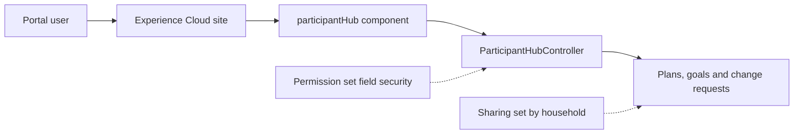

# Participant Hub

An accessible participant portal for nonprofit support organisations, built on **Salesforce Experience Cloud**. Participants and families sign in to see their support plan and goals, update how they like to be contacted, and request changes that staff review. Display settings (text size, high contrast and an Easy Read view) are built in.

## Demo video

[screen-capture (3).webm](https://github.com/user-attachments/assets/3b40fd31-4109-4687-9c1e-9c24cfd707a8)


> Demo project. All people, organisations and plan details are fictional. The data model is **inspired by** Salesforce Nonprofit Cloud (programs, enrollments, plans) but uses custom objects, so it runs in a free Developer Edition org. It is not built on Nonprofit Cloud.

## Features

| Feature | How it works |
|---|---|
| My support plan | Status, hours, dates, summary and goals with progress bars |
| Easy Read mode | Swaps in the plain-language summary, simpler headings and labels, and wider line spacing |
| Display settings | Text size (5 steps), high contrast and Easy Read toggle, remembered in the browser |
| Communication preferences | Participants edit preferred contact method, communication needs, support person and Easy Read default |
| Change requests | Participants send a request. Staff approve or decline in Salesforce, and the participant sees the outcome and reply |
| Household access | A participant or family member sees only their own household's plan. Draft plans are hidden |

### Accessibility

Designed with WCAG 2.2 AA principles in mind: native HTML form controls with explicit labels, 44px minimum touch targets, visible focus outlines, status messages announced through live regions, progress bars exposed with ARIA values, state shown in text as well as colour, and a high contrast theme.

This has **not** had a formal audit or been tested with assistive technology yet, so it makes no claim of WCAG conformance. See [Limitations](#limitations).

## How it fits together



- **Experience Cloud (LWR)** hosts the site. Portal users have the Customer Community Plus licence.
- **Lightning Web Components**: `participantHub` is the page component. It holds display settings and loads the plan, and four child components render the toolbar, plan summary, preferences form and change requests.
- **Apex**: `ParticipantHubController` runs `with sharing` and uses user mode for every query and save, so record access and field-level security are always enforced.
- **Security model**: a sharing set grants each portal user access to plans for their own household. The portal permission set lets them edit only the communication fields and create change requests.

## Data model

| Object | Purpose |
|---|---|
| `Program__c` | A service participants can be enrolled in |
| `Program_Enrollment__c` | A participant's membership in a program (status, start date) |
| `Support_Plan__c` | The plan: summary, Easy Read summary, hours, dates, status, communication preferences |
| `Plan_Goal__c` | Goals within a plan, with progress (master-detail to plan) |
| `Plan_Change_Request__c` | A change requested from the portal (master-detail to plan) |

Participants are standard Contacts under household Accounts. Two validation rules keep plans consistent: the end date must follow the start date, and an Active plan needs both dates and support hours.

## Project layout

```
force-app/main/default/
  objects/            5 custom objects, fields and validation rules
  layouts/            page layouts for the staff view
  permissionsets/     Participant_Hub_Staff and Participant_Hub_Portal
  classes/            ParticipantHubController and its tests
  lwc/                participantHub plus four child components and a shared utils module
scripts/apex/seed-data.apex   fictional participants, plans, goals and requests
```

## Set up your own copy

You need the [Salesforce CLI](https://developer.salesforce.com/tools/salesforcecli) (`sf`) and a free [Developer Edition org](https://developer.salesforce.com/signup).

```bash
sf org login web --set-default --alias participant-hub
sf project deploy start --target-org participant-hub
sf org assign permset --name Participant_Hub_Staff --target-org participant-hub
sf apex run --file scripts/apex/seed-data.apex --target-org participant-hub
```

Always pass `--target-org` so nothing lands in another connected org. Run the seed script only once.

Then set up the site in the org:

1. Enable Digital Experiences, then create a site from the **Build Your Own (LWR)** template and add the **Customer Community Plus User** profile as a member.
2. In Digital Experiences > Settings, allow standard external profiles, and make sure the household Account owner has a role.
3. Add the **Enable Customer User** and **Log in to Experience as User** actions to the Contact layout. Enable a customer user from a participant Contact and assign `Participant_Hub_Portal` to that user.
4. Create a sharing set: Support Plan, `User: Contact.Account` = `Support Plan: Household`, access **Read/Write**. Read/Write is needed so preferences save and requests can be created. Field-level security still limits what can be edited.
5. In Experience Builder, drag **Participant Hub** onto the Home page, set the page to require login, and publish.

## Demo script

1. Log in as a participant with **Log in to Experience as User**. The plan and goals appear.
2. Turn on **Easy Read**. The summary, headings and statuses switch to plain language.
3. Increase the text size and turn on **High contrast**.
4. Change the preferred contact method and save. Open the same plan in Salesforce and the field has changed.
5. Send a change request. In Salesforce, set it to **Approved** with a staff response. Refresh the portal and the outcome appears.

## Limitations

- Not formally audited for accessibility. Next steps are axe or Lighthouse checks, keyboard-only testing and a screen reader pass.
- High contrast restyles the Participant Hub component only, not the site's header or the page around it.
- Staff changes appear on refresh. There is no live update in the portal.
- Plan approval, staff approval screens and notifications are not built yet.
- The Apex tests expect the `Participant_Hub_Staff` permission set to be deployed. A Developer Edition deploy skips tests by default, so run them yourself:
  `sf apex run test --class-names ParticipantHubControllerTest --result-format human --wait 10 --target-org participant-hub`

## Ideas to extend it

- A staff approval screen for change requests, with a Flow that updates the plan.
- A participant approval step for plans awaiting approval.
- Pictures for each goal in Easy Read.
- Email notifications when a request is decided.

## Built with

Salesforce Experience Cloud (LWR), Lightning Web Components, Apex, Salesforce CLI and VS Code. I set the idea, scope and accessibility focus, and did the Experience Cloud setup and testing. Claude helped with the data modelling, Apex, components, permission sets, layouts, sample data and debugging.

## Licence

MIT. See [LICENSE](LICENSE).
